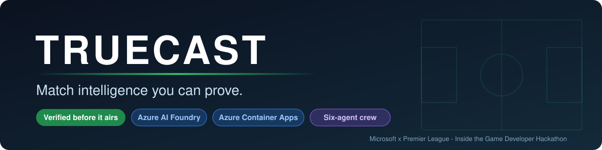
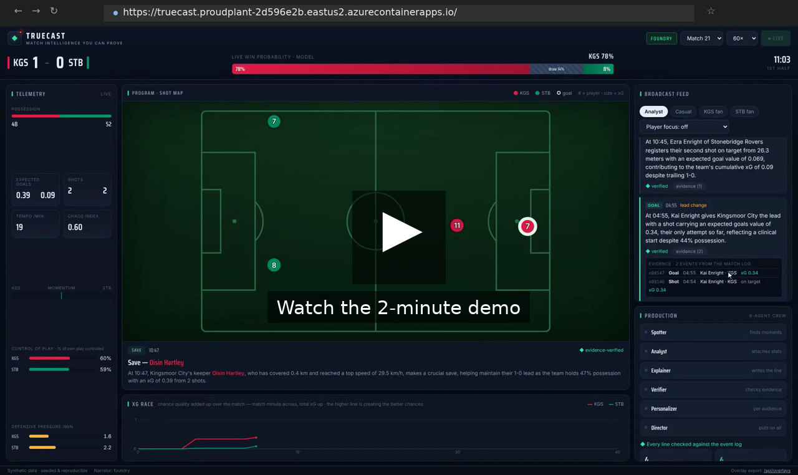
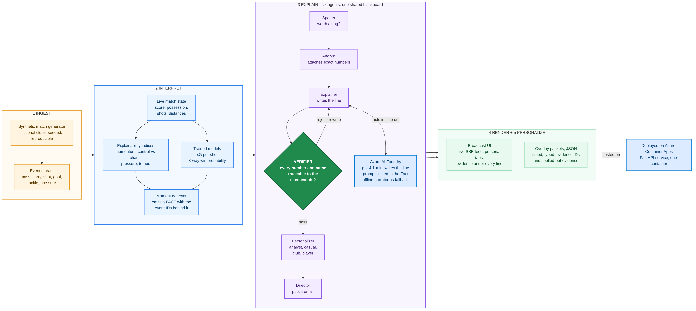

<p align="center"></p>

<p align="center">
  
  
  
  
  
</p>

Truecast is a live match-intelligence system for football broadcast. A stream
of match events goes in; verified, explainable, audience-specific on-air lines
and machine-readable graphics packets come out. Six specialised agents produce
every line, and a **Verifier** agent checks each one against the event log
before it airs. Nothing reaches the screen that the data cannot back.

> Built for the Microsoft × Premier League *Inside the Game: Developer
> Hackathon*. All match data is synthetic; no real match data or club
> trademarks are used.

**Live app:** <https://truecast.proudplant-2d596e2b.eastus2.azurecontainerapps.io>
· **Demo video:** [docs/truecast-demo.mp4](docs/truecast-demo.mp4) (1:55)
· **Docs:** [Architecture](ARCHITECTURE.md) · [Pitch](PITCH.md) · [Azure setup](AZURE_SETUP.md)

---

## Demo video

<p align="center">
  <a href="docs/truecast-demo.mp4"></a>
</p>

Under two minutes, recorded against the live Azure deployment with the Foundry
narrator on: a goal airs, the evidence behind it is opened, the same moment is
retold for three audiences, the six agents and the Verifier's counters, the
trained models, and the machine-readable overlay packets.

---

## Contents

1. [Demo video](#demo-video)
2. [The idea in one moment](#the-idea-in-one-moment)
3. [How it works](#how-it-works)
4. [The Verifier](#the-verifier)
5. [Try it in two minutes](#try-it-in-two-minutes)
6. [What you will see](#what-you-will-see)
7. [Azure](#azure)
8. [Trained models](#trained-models)
9. [HTTP API](#http-api)
10. [Tests](#tests)
11. [Repository map](#repository-map)

---

## The idea in one moment

Live broadcast graphics have to be right. A generated line that invents a
stat or names the wrong scorer is worse than no line at all, and no broadcaster
will put an unverifiable number on air. Most "AI commentary" demos generate
fluent text and hope it is accurate.

Truecast makes grounding a hard guarantee. Agents only ever speak about
**Facts**: neutral, machine-checkable statements that carry the IDs of the
events that justify them. Before a line airs, the Verifier rebuilds an
allow-list from those events and rejects the line if it contains a number or a
name it cannot support. A rejected line is rewritten; the worst case is a
plainer true sentence, never a confident false one.

A real moment from match 21, exactly as the app shows it:

```
04:55  ✓  [goal]  GOAL. Kai Enright finds the net for Kingsmoor City at 04:55.
                  It's KGS 1-0 STB. That chance was worth 0.34 xG.
       └─ evidence (2 events from the match log)
            e00147  goal   04:55  Kai Enright · KGS             xG 0.34
            e00146  shot   04:54  Kai Enright · KGS  on target  xG 0.34
```

Click **evidence** under any line and this is what opens. The scorer, the time
and the xG the line quotes are read straight off the cited events. The same
spelled-out evidence travels inside every overlay packet, so a graphics partner
never needs a lookup to see why a graphic is justified.

---

## How it works

One pipeline, five stages, read left to right. Events become live state and
metrics; the engine turns notable moments into Facts; six agents turn a Fact
into a line that must pass the Verifier; the Director delivers it to the UI
and as an overlay packet. Azure AI Foundry writes the words; Azure Container
Apps hosts the service.

<p align="center"></p>

<p align="center"><sub>Orange = data in · blue = engine and models · purple = agent crew · green diamond = the Verifier gate · light blue = Azure · green = what leaves the system. Source: <a href="docs/architecture.mmd"><code>docs/architecture.mmd</code></a>.</sub></p>

### The five stages

| # | Stage | What happens | Code |
|---|-------|--------------|------|
| 1 | **Ingest** | synthetic events arrive: passes, carries, shots, goals, tackles, pressure | `generator/` |
| 2 | **Interpret** | live stats, model xG, win probability, momentum, control vs chaos, pressure, tempo; notable moments become Facts | `engine/`, `ml/` |
| 3 | **Explain** | a Fact becomes a line, written by the model and then verified | `agents/` |
| 4 | **Render** | timed, typed overlay packets with their evidence, for a graphics partner | `overlay/`, `api/` |
| 5 | **Personalize** | the same moment retold for an analyst, a casual fan, a club supporter or a player follower | `personas.py`, `agents/personalizer.py` |

### The six agents

All six share one blackboard and hand work to each other explicitly, so every
step is inspectable.

| Agent | One job |
|-------|---------|
| **Spotter** | decides whether a detected moment is worth airing |
| **Analyst** | attaches the exact supporting numbers from live state |
| **Explainer** | writes the line (Azure AI Foundry, or the offline narrator) |
| **Verifier** | checks every number and name against the evidence; bounces failures back |
| **Personalizer** | renders the moment once per audience |
| **Director** | puts the chosen line on air and emits the overlay packet |

---

## The Verifier

The part worth understanding. For each line the Verifier builds an allow-list
and rejects anything outside it:

- **Numbers:** every figure in the Fact and the Analyst's packet, plus the
  clock and scoreline, expanded with the rounding a line might legitimately use.
- **Names:** only the players and teams tied to this moment's Fact.

| Line | Verdict | Why |
|------|---------|-----|
| "Kai Enright finds the net at 04:55. That chance was worth 0.34 xG." | ✓ airs | every figure and name is in the evidence |
| "Kai Enright hit 38.7 km/h in the build-up." | ✗ rejected | 38.7 appears nowhere in the data |
| "Teddy Zielinski finishes it off." | ✗ rejected | real player, but not part of this moment |

A rejected line goes back to the Explainer, which rewrites from the supplied
figures only. The Production panel counts every outcome live: **moments read,
on air, rewritten, blocked**. With a live model those last two occasionally
tick up; that is the guardrail doing its job.

---

## Try it in two minutes

Runs fully offline with no API key or cloud account.

```bash
pip install -r requirements.txt
pip install -e .

truecast serve                 # live broadcast UI at http://127.0.0.1:8000
truecast replay --seed 21      # run the crew over a match, print the recap
truecast generate --seed 21    # write raw synthetic match data to data/
```

To have Azure AI Foundry write the lines, copy `.env.example` to `.env`, fill
in the endpoint and key, and run `truecast check-foundry`. Details in
[`AZURE_SETUP.md`](AZURE_SETUP.md).

---

## What you will see

Press **▶ Kick off** and a match replays at the speed you choose.

- **Feed:** every aired line with its kind, clock and context (equaliser, lead
  change). Under each line, **◆ verified** and an **evidence** toggle that lists
  the cited events.
- **Persona tabs:** the same moment as an analyst, a casual fan or either
  club's supporter would hear it. A player picker filters the feed to one player.
- **Lower third:** the latest line as a broadcast graphic, plus live score,
  possession, xG race and a three-way win-probability bar.
- **Pitch map:** every shot, sized by xG.
- **Production panel:** the six agents lighting up as each moment passes
  through them, the Verifier's counters, the narrator mode badge
  (**offline** or **foundry**) and the trained models' held-out metrics.
- **`/api/overlays?seed=21`:** the whole match as machine-readable packets.

Five featured matches are offered in the picker (seeds 21, 11, 42, 99, 7).
Every seed is reproducible byte-for-byte.

---

## Azure

| Service | Role |
|---------|------|
| **Azure AI Foundry** | `gpt-4.1-mini` deployment writes each line from a prompt limited to the Fact and its numbers. Output still passes the Verifier, so a model that drifts is caught, not trusted. If Foundry is unreachable, generation falls back to the offline narrator and the feed keeps running. |
| **Azure Container Apps** | hosts the FastAPI service as one container, built in the cloud with `az containerapp up`; `/healthz` backs its probes. Bicep for the infrastructure-as-code path is in `infra/`. |

The crew is structured to the Microsoft Agent Framework's model (single-purpose
agents, a shared thread, explicit handoffs) without depending on it; see
[`ARCHITECTURE.md`](ARCHITECTURE.md#mapping-to-the-microsoft-agent-framework).

---

## Trained models

Two scikit-learn models are trained offline on simulated matches and shipped
as small JSON files. Inference is pure Python, so the service carries no ML
dependency. Metrics are on matches held out from training (split by match,
never by row) and are shown live in the Production panel via `/api/models`.

| Model | Type | Held-out metrics | Used for |
|-------|------|------------------|----------|
| **Win probability** | multinomial logistic, home / draw / away | 67% accuracy, 0.71 log-loss | the win-probability bar, updated every tick |
| **xG** | logistic regression on shot features | Brier 0.07, AUC 0.80 | shot quality on the pitch map, team xG totals, the figure in every goal line |

The simulator has no explicit win-probability function, so that model learns an
emergent outcome; the xG model recovers the generator's shot-conversion function,
the same workflow a real xG model uses on event data. Retrain with:

```bash
pip install -e ".[train]"
python -m truecast.ml.train --matches 400
```

---

## HTTP API

| Endpoint | Purpose |
|----------|---------|
| `GET /api/meta?seed=21` | squads, colours, narrator mode |
| `GET /api/stream?seed=21&speed=60` | server-sent events: scoreboard ticks, aired lines, overlay packets |
| `GET /api/overlays?seed=21` | full overlay timeline; each packet carries `evidence` (event IDs) and `evidence_detail` (those events spelled out) |
| `GET /api/personalize?seed=21&overlay_id=ov0002&mode=club&team_id=KGS` | re-render one moment for a club or player viewer |
| `GET /api/recap?seed=21` | end-of-match recap |
| `GET /api/models` | trained-model provenance and held-out metrics |
| `GET /healthz` | liveness probe; reports the narrator mode |

---

## Tests

```bash
pytest          # 39 tests, also run on every push by GitHub Actions
```

Covers the generator (reproducibility, schema, xG geometry), the engine
(possession, distances, index bounds), the trained models (loading, calibration,
monotonicity), the full crew (including that every cited event is spelled out
and a goal's evidence names the scorer and the xG the line quotes), the API, the
Foundry HTTP path against a mock endpoint, and the Verifier: grounded lines
pass, unsupported numbers and wrong players are rejected, scorelines and clocks
are not falsely flagged.

---

## Repository map

```
src/truecast/
  generator/   synthetic match simulator (fictional clubs, seeded events)
  engine/      live state, metrics, explainability indices, moment detection
  ml/          trained win-probability + xG models (train offline, infer in-process)
  agents/      the six-agent crew and its orchestration
  llm/         narrative providers: offline narrator and Azure AI Foundry
  overlay/     overlay packet schema
  api/         FastAPI server: SSE stream, personalize, export, health, models
  cli.py       serve / replay / generate / check-foundry
web/           broadcast UI (single HTML file)
infra/         Bicep for Azure Container Apps, Foundry runbook, deploy notes
docs/          demo video + thumbnail, architecture diagram (source + render), banner
tests/         pytest suite
```

| Document | Read it for |
|----------|-------------|
| [`ARCHITECTURE.md`](ARCHITECTURE.md) | the data contract, each engine index, how the Verifier builds its allow-list, failure recovery, the Agent Framework mapping |
| [`PITCH.md`](PITCH.md) | the project summary for the hackathon |
| [`AZURE_SETUP.md`](AZURE_SETUP.md) | zero to a live Foundry-powered deployment from Cloud Shell |
| [`infra/deploy.md`](infra/deploy.md) · [`infra/FOUNDRY_RUNBOOK.md`](infra/FOUNDRY_RUNBOOK.md) | the Bicep path, and turning the Foundry narrator on locally |

### Synthetic data

The generator produces full matches from a possession-based model: fictional
clubs and squads, realistic event sequences, xG from shot geometry, pass
difficulty, ball and player speeds, and off-ball running that brings players to
realistic match distances (10–11 km). The schema is in `src/truecast/models.py`.

### License

MIT — see [`LICENSE`](LICENSE).
