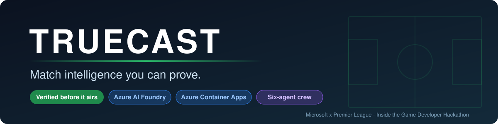
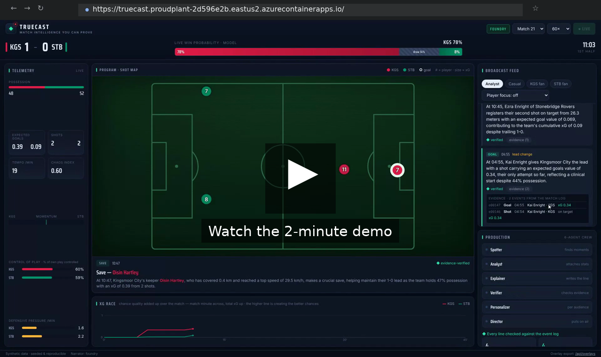
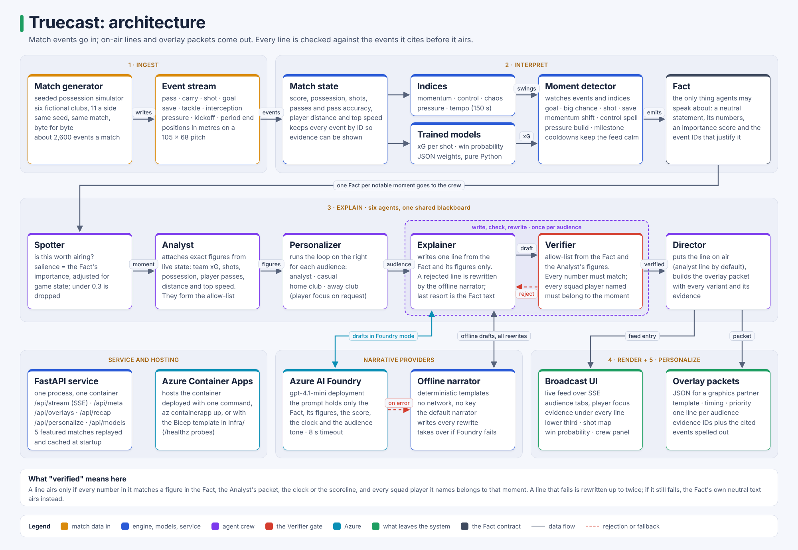

<p align="center"></p>

<p align="center">
  <a href="https://github.com/demonjd2026-afk/truecast/actions/workflows/ci.yml"></a>
  
  
  
  
  
</p>

Truecast is a live match-intelligence system for football broadcast. A stream
of match events goes in; on-air lines for each audience and machine-readable
graphics packets come out. Six agents produce every line, and a **Verifier**
agent checks it against the event log before it airs. A line that quotes a
number the data does not hold, or names a squad player who was not part of the
moment, is rejected and rewritten.

> Built for the Microsoft × Premier League *Inside the Game: Developer
> Hackathon*. All match data is synthetic; no real match data or club
> trademarks are used.

| | |
|---|---|
| **Live app** | <https://truecast.proudplant-2d596e2b.eastus2.azurecontainerapps.io> |
| **Demo video** | [`docs/truecast-demo.mp4`](docs/truecast-demo.mp4) (1:55) |
| **Docs** | [Architecture](ARCHITECTURE.md) · [Pitch](PITCH.md) · [Azure setup](AZURE_SETUP.md) |

## At a glance

| | |
|---|---|
| **What it does** | Turns match events into live stats, key moments with the reason they matter, and one line per audience |
| **The guarantee** | No line airs with a number or a squad player the match data does not support |
| **Agents** | Spotter, Analyst, Personalizer, Explainer, Verifier, Director, sharing one blackboard |
| **Models** | xG and three-way win probability, trained with scikit-learn, served as JSON weights in pure Python |
| **Azure** | Azure AI Foundry (`gpt-4.1-mini`) writes the lines; Azure Container Apps hosts the service |
| **Stack** | Python 3.11+, FastAPI, server-sent events, a single-file web UI, Bicep, Docker |
| **Tests** | 40 pytest tests, run on Python 3.11 and 3.12 by GitHub Actions |
| **Runs offline** | Yes. No API key or cloud account is needed; a deterministic narrator writes the lines |

## Contents

1. [The problem and the idea](#1-the-problem-and-the-idea)
2. [Demo](#2-demo)
3. [Quickstart](#3-quickstart)
4. [Architecture](#4-architecture)
5. [The Verifier](#5-the-verifier)
6. [The broadcast UI](#6-the-broadcast-ui)
7. [Trained models](#7-trained-models)
8. [HTTP API](#8-http-api)
9. [Azure](#9-azure)
10. [Tests and CI](#10-tests-and-ci)
11. [Repository map](#11-repository-map)
12. [Scope and limits](#12-scope-and-limits)
13. [License](#13-license)

---

## 1. The problem and the idea

Live broadcast graphics have to be right. A generated line that invents a stat
or names the wrong scorer is worse than no line, and no broadcaster will put a
number on air that nobody can check. Most AI commentary demos generate fluent
text and hope it is accurate.

Truecast checks instead of hoping. Agents only speak about **Facts**: neutral,
machine-checkable statements that carry the IDs of the events that justify
them. Before a line airs, the Verifier builds an allow-list from the Fact and
its supporting figures and rejects the line if it contains a number or a squad
player outside that list. A rejected line is rewritten; the worst case is a
plainer true sentence.

A real moment from match 21, as `truecast replay --seed 21` prints it (offline
narrator, analyst line):

```
04:55  ✓  [goal]  GOAL. Kai Enright finds the net for Kingsmoor City at 04:55. It's KGS 1-0 STB. That chance was worth 0.34 xG. [team xG 0.34, 1 shots, 44% possession]
```

And the evidence that travels with it in the overlay packet
(`GET /api/overlays?seed=21`, packet `ov0002`):

```json
"evidence": ["e00147", "e00146"],
"evidence_detail": [
  {"event_id": "e00147", "type": "goal", "clock": "04:55", "team": "KGS", "player": "Kai Enright", "xg": 0.34},
  {"event_id": "e00146", "type": "shot", "clock": "04:54", "team": "KGS", "player": "Kai Enright", "outcome": "on target", "xg": 0.34}
]
```

The scorer, the time and the xG in the line can be read straight off the cited
events. In the UI the same records open under the **evidence** button on every
line, so neither a viewer nor a graphics partner needs a lookup to see why a
line is justified.

---

## 2. Demo

<p align="center">
  <a href="docs/truecast-demo.mp4"></a>
</p>

1 minute 55 seconds, recorded against the Azure deployment with the Foundry
narrator on: a goal airs, the evidence behind it is opened, the same moment is
retold for three audiences, then the six agents and the Verifier's counters,
the trained models, and the overlay packets.

---

## 3. Quickstart

Runs fully offline. Python 3.11 or newer.

```bash
git clone https://github.com/demonjd2026-afk/truecast.git
cd truecast
pip install -e .

truecast serve                 # broadcast UI at http://127.0.0.1:8000
```

Press **▶ Kick off** in the UI and a match replays.

### Command line

| Command | What it does | Options (defaults) |
|---------|--------------|--------------------|
| `truecast serve` | starts the API and the UI | `--host 127.0.0.1` `--port 8000` |
| `truecast replay` | runs the crew over one match and prints the top moments | `--seed 21` `--top 12` |
| `truecast generate` | writes a match to `<match_id>.events.jsonl` and `<match_id>.meta.json` | `--seed 21` `--count 1` `--out data` |
| `truecast check-foundry` | probes the Foundry endpoint and key; exits non-zero if the probe fails | none |

`truecast replay --seed 21` starts like this:

```
Kingsmoor City vs Stonebridge Rovers  —  KGS 2-3 STB  [offline]
moments read 46 | on air 40 | rewritten 0 | blocked 0
```

### Let Azure AI Foundry write the lines

Truecast reads its settings from the environment. It does not load `.env` by
itself, so export the file after filling it in:

```bash
cp .env.example .env           # fill in the endpoint and key
set -a; . ./.env; set +a
truecast check-foundry         # expect: probe: OK
truecast serve                 # the badge in the top bar now reads "foundry"
```

| Variable | Default | Purpose |
|----------|---------|---------|
| `AZURE_AI_FOUNDRY_ENDPOINT` | empty | `https://<resource>.openai.azure.com` |
| `AZURE_AI_FOUNDRY_API_KEY` | empty | key for that resource |
| `AZURE_AI_FOUNDRY_DEPLOYMENT` | `gpt-4.1-mini` | chat deployment name |
| `AZURE_AI_FOUNDRY_API_VERSION` | `2024-10-21` | API version |
| `TRUECAST_WEB_DIR` | auto-detected | folder holding `index.html`; set in the Docker image |

Foundry mode switches on when both the endpoint and the key are set. Otherwise
the offline narrator is used. The full walkthrough is in
[`AZURE_SETUP.md`](AZURE_SETUP.md) and
[`infra/FOUNDRY_RUNBOOK.md`](infra/FOUNDRY_RUNBOOK.md).

---

## 4. Architecture

<p align="center"></p>

<p align="center"><sub>Orange = match data in · blue = engine, models, service · purple = agent crew · red = the Verifier gate · teal = Azure · green = what leaves the system · dark grey = the Fact contract · dashed red = rejection or fallback.</sub></p>

Read it top to bottom. The top row turns events into live state and, for each
notable moment, one Fact. The middle row is the crew that turns a Fact into
verified lines. The bottom row is what the crew leans on (the narrators), what
it produces (the feed and the overlay packets) and what hosts it.

### The five stages

| # | Stage | What happens | Code |
|---|-------|--------------|------|
| 1 | **Ingest** | a seeded simulator emits events: pass, carry, shot, goal, save, tackle, interception, pressure | `generator/` |
| 2 | **Interpret** | live stats, model xG, win probability, and the momentum, control, chaos, pressure and tempo indices; notable moments become Facts | `engine/`, `ml/` |
| 3 | **Explain** | each Fact becomes a line that must pass the Verifier | `agents/`, `llm/` |
| 4 | **Render** | every aired moment becomes a feed entry and a timed, typed overlay packet carrying its evidence | `agents/director.py`, `overlay/`, `api/` |
| 5 | **Personalize** | the same moment is written for an analyst, a casual fan and each club's supporters; a player-focused line is rendered on request | `personas.py`, `agents/personalizer.py` |

Personalization happens inside the crew, before render: every audience's line
goes through the Verifier, so no variant skips the check.

### The six agents

They share one `Blackboard` (match state, the feed, the overlays, the counters
and a handoff trace) and run in this order for each Fact:

| Agent | One job |
|-------|---------|
| **Spotter** | scores the moment's salience from the Fact's importance and the game state; drops anything under 0.3; tags equalisers and lead changes |
| **Analyst** | attaches exact figures from live state (team xG, shots, possession, the player's passes, distance and top speed); these become the Verifier's allow-list |
| **Personalizer** | runs the Explainer and Verifier loop once per audience and collects the variants |
| **Explainer** | writes the line through the active narrator; rewrites a rejected line with the offline narrator; the last resort is the Fact's own text |
| **Verifier** | checks every number and every squad player in the line against the allow-list; rejects on any miss |
| **Director** | puts the analyst line on air by default and builds the overlay packet with every variant and the evidence |

The trace records the Analyst → Explainer handoff, every Verifier → Explainer
rejection and the Personalizer → Director handoff.

### What a Fact is

A `Fact` ([`src/truecast/models.py`](src/truecast/models.py)) holds a kind, a
neutral text statement, the structured numbers behind it, an importance score
and the IDs of the events that justify it. The detector emits eight kinds:
`goal`, `big_chance`, `shot`, `save`, `momentum_shift`, `control_spell`,
`pressure_build` and `milestone`. Lines are generated *from* Facts and checked
*against* them, never generated freely and trusted.

More detail on every component is in [`ARCHITECTURE.md`](ARCHITECTURE.md).

---

## 5. The Verifier

### What it checks

For each line the Verifier builds an allow-list and rejects anything outside it.

- **Numbers.** Every number in the line must match a figure in the Fact or the
  Analyst's packet, or a digit group from the clock or the scoreline. A figure
  may appear as given, rounded to one or two decimals, rounded to an integer,
  or as a percentage when it is a fraction between 0 and 1.
- **Squad players.** Any player from either squad who is named in full in the
  line must be a player attached to this moment.

| Line | Verdict | Why |
|------|---------|-----|
| "Kai Enright finds the net at 04:55. That chance was worth 0.34 xG." | ✓ airs | every number and the player are in the evidence |
| "Kai Enright hit 38.7 km/h in the build-up." | ✗ rejected | 38.7 appears nowhere in the data |
| "Teddy Zielinski finishes it off." | ✗ rejected | a real squad player, but not part of this moment |

### What happens to a rejected line

1. **Draft.** The active narrator (Foundry or offline) writes the line and the Verifier checks it.
2. **Rewrite.** A rejected line goes back to the Explainer, which rewrites it with the offline narrator from the supplied figures only. Up to two rewrites.
3. **Fall back.** If it still fails, the Fact's own neutral text airs instead.

The Production panel counts the outcomes live: **moments read**, **put on
air**, **rewritten** and **blocked**. Rewritten and blocked count lines, one
per audience. With a live model they tick up now and then; that is the check
doing its job.

### What it does not check

The check is deliberately narrow, and these are outside it:

- team names, and names that belong to neither squad;
- a player referred to by surname only;
- whether a number is attached to the right thing: a figure that exists in the
  allow-list passes wherever the line uses it;
- wording with no number or name in it, such as an adjective describing a goal.

The Foundry prompt tells the model to use only the supplied facts, but only
the two checks above are enforced in code.

---

## 6. The broadcast UI

Press **▶ Kick off** and a match replays at 40×, 60× (the default), 120× or
maximum speed.

- **Feed.** Every aired line with its kind, clock and context tag. Each line
  has an **evidence** button that lists the cited events.
- **Audience tabs.** Analyst, Casual, Home and Away show the same moment in
  four voices. The player picker filters the feed to one player.
- **Lower third.** The latest line as a broadcast graphic.
- **Scoreboard and telemetry.** Score, possession, shots, an xG race chart, a
  three-way win-probability bar, and the momentum, control, chaos, pressure and
  tempo readings.
- **Shot map.** One marker per shooter, placed at their best chance and sized
  by their total xG.
- **Production panel.** The six agents lighting up as each moment passes
  through, the Verifier's counters, and the trained models' held-out metrics.
  The narrator badge (**offline** or **foundry**) is in the top bar.

Five matches are offered in the picker (seeds 21, 11, 42, 99 and 7). A seed
always reproduces the same match, byte for byte.

---

## 7. Trained models

Two scikit-learn models are trained offline on 400 simulated matches and
shipped as small JSON files. Inference is pure Python, so the service has no
ML dependency. The split is by match, never by row: 320 matches train, 80 are
held out.

| Model | Type and features | Held-out metrics | Used for |
|-------|-------------------|------------------|----------|
| **xG** | logistic regression on distance, angle, header, big chance, under pressure | Brier 0.071, AUC 0.80, log-loss 0.255 (2,857 shots) | the xG shown on the shot map, in team totals and in every goal line |
| **Win probability** | multinomial logistic (home / draw / away) on minute, score difference, xG difference, shots difference, momentum, possession difference | 66.9% accuracy, log-loss 0.712 (1,440 snapshots) | the win-probability bar, refreshed every match minute |

Both metrics are measured against the simulator, not real football. The xG
model recovers the generator's own shot-conversion function; the simulator has
no win-probability function, so that model learns the outcome from match
state. If a JSON file is missing, each model falls back to a closed-form
formula. `GET /api/models` returns the metrics, and the Production panel shows
them.

Retrain with:

```bash
pip install -e ".[train]"
python -m truecast.ml.train --matches 400
```

---

## 8. HTTP API

| Endpoint | Purpose |
|----------|---------|
| `GET /` | the broadcast UI |
| `GET /api/meta?seed=21` | fixture, venue, squads, colours and the narrator mode |
| `GET /api/stream?seed=21&speed=60` | server-sent events for a live replay (see below); `speed=0` runs without pauses |
| `GET /api/overlays?seed=21` | the whole match as overlay packets |
| `GET /api/personalize?seed=21&overlay_id=ov0002&mode=club&team_id=KGS` | one aired moment re-rendered for a club (`mode=club`, `team_id`) or a player (`mode=player`, `player_id`); written by the offline narrator and verified |
| `GET /api/recap?seed=21` | the ten highest-salience moments in match order, with the final score and counters |
| `GET /api/models` | trained-model metrics |
| `GET /healthz` | liveness probe; reports the narrator mode |
| `GET /docs` | FastAPI's interactive API docs |

### Stream events

| Event | Sent | Payload |
|-------|------|---------|
| `meta` | once, first | fixture, team codes, narrator mode |
| `tick` | every match minute, and at full time | clock, score, possession, team stats, indices, win probability, shots |
| `air` | for every aired moment | the line, all audience variants, `evidence`, `evidence_detail`, `verified` |
| `recap` | at full time | the recap |
| `done` | last | empty |

### Overlay packet

One packet per aired moment (trimmed):

```json
{
  "overlay_id": "ov0002",
  "clock": "04:55",
  "kind": "goal",
  "template": "lower_third_goal",
  "priority": 0.98,
  "duration_s": 10.0,
  "headline": "GOAL — Kai Enright",
  "variants": {"analyst": "...", "casual": "...", "club_KGS": "...", "club_STB": "..."},
  "data": {"scorer": "Kai Enright", "xg": 0.34, "team_xg": 0.34, "possession": 44},
  "evidence": ["e00147", "e00146"],
  "evidence_detail": [{"event_id": "e00147", "type": "goal", "clock": "04:55", "team": "KGS", "player": "Kai Enright", "xg": 0.34}],
  "verified": true
}
```

`template` is one of `lower_third_goal`, `stat_flash`, `momentum_bar` or
`player_card`; a rendering partner maps it to its own graphics and picks the
variant for each viewer. `priority` is the Spotter's salience, and `duration_s`
grows with it.

---

## 9. Azure

| Service | Role |
|---------|------|
| **Azure AI Foundry** | A `gpt-4.1-mini` deployment writes each line, one call per audience per moment. The prompt holds only the Fact, its figures, the score, the clock and the audience tone. The output still passes the Verifier. If a call fails or takes longer than 8 seconds, that line comes from the offline narrator and the feed keeps running. |
| **Azure Container Apps** | Hosts the FastAPI service as one container. `az containerapp up` builds and deploys it in one command; `infra/main.bicep` is the infrastructure-as-code path, with `/healthz` liveness and readiness probes, a Log Analytics workspace and HTTP autoscaling. |

At startup the service replays the five featured matches and caches them, so
the overlay, recap and personalize endpoints answer without waiting. In Foundry
mode that warm-up takes roughly 15 minutes because every line is a model call.

The crew is structured to the Microsoft Agent Framework's model (single-purpose
agents, a shared thread, explicit handoffs) without importing it; see
[`ARCHITECTURE.md`](ARCHITECTURE.md#mapping-to-the-microsoft-agent-framework).

Deployment guides: [`AZURE_SETUP.md`](AZURE_SETUP.md) (zero to a live URL from
Cloud Shell) and [`infra/deploy.md`](infra/deploy.md) (the Bicep path).

---

## 10. Tests and CI

```bash
pip install -e ".[dev]"
pytest          # 40 tests
```

| File | Tests | Covers |
|------|-------|--------|
| `tests/test_generator.py` | 6 | reproducibility, event schema and bounds, squads, xG geometry |
| `tests/test_engine.py` | 6 | possession, player distances, index ranges, Facts carry evidence |
| `tests/test_ml.py` | 5 | models load, xG is monotonic, win probability sums to one, goals marked on the shot map |
| `tests/test_crew.py` | 8 | the full pipeline, every aired line verified, handoffs recorded, club lines differ, evidence spelled out, goal context tags |
| `tests/test_verifier.py` | 6 | grounded lines pass; an invented number and a wrong player are rejected; scorelines and clocks are not flagged |
| `tests/test_api.py` | 5 | meta, recap, overlay export, personalize (with the score at the moment), the UI is served |
| `tests/test_foundry.py` | 4 | the Foundry HTTP path against a mock endpoint, the health probe, fallback when unreachable |

GitHub Actions ([`.github/workflows/ci.yml`](.github/workflows/ci.yml)) runs
the suite on Python 3.11 and 3.12 for every push to `main` and every pull
request.

---

## 11. Repository map

```
src/truecast/
  models.py      the data contract: Event, Fact, Team, Player, MatchMeta
  config.py      settings read once from the environment
  personas.py    analyst, casual, club and player audiences
  cli.py         serve / replay / generate / check-foundry
  generator/     synthetic match simulator (fictional clubs, seeded events)
  engine/        live state, shared formulas, the five indices, moment detection
  ml/            xG and win-probability models: training script, JSON weights, inference
  agents/        the six agents, the blackboard and the crew that wires them
  llm/           narrators: Azure AI Foundry and the offline narrator
  overlay/       overlay packet schema
  api/           FastAPI server: SSE stream, overlays, recap, personalize, models, health
web/             broadcast UI (one HTML file)
infra/           Bicep for Azure Container Apps, Foundry runbook, deploy notes
docs/            architecture diagram, banner, demo video and thumbnail
tests/           pytest suite
.github/         CI workflow
Dockerfile       the container image the service runs in
```

| Document | Read it for |
|----------|-------------|
| [`ARCHITECTURE.md`](ARCHITECTURE.md) | the data contract, each engine index, how the Verifier builds its allow-list, failure recovery, the Agent Framework mapping |
| [`PITCH.md`](PITCH.md) | the project summary for the hackathon |
| [`AZURE_SETUP.md`](AZURE_SETUP.md) | zero to a live Foundry-powered deployment from Cloud Shell |
| [`infra/deploy.md`](infra/deploy.md) · [`infra/FOUNDRY_RUNBOOK.md`](infra/FOUNDRY_RUNBOOK.md) | the Bicep path, and turning the Foundry narrator on locally |

---

## 12. Scope and limits

- **Synthetic data only.** Matches come from a possession-based simulator with
  six fictional clubs. Nothing here has been run on real match data.
- **Model metrics describe the simulator.** They show the training and
  evaluation workflow, not accuracy on real football.
- **The Verifier checks numbers and full squad-player names.** See
  [what it does not check](#what-it-does-not-check).
- **English only.** Lines are generated in English.
- **In memory.** Match state and replays live in the process; nothing is
  persisted, and the replay cache holds eight matches.
- **Agent Framework.** The crew mirrors its structure but does not depend on it.

---

## 13. License

MIT. See [`LICENSE`](LICENSE).
